# Securities Lending & Equity Finance Simulator

[](https://github.com/crollila/securities-lending-equity-finance/actions/workflows/ci.yml)
[](https://www.python.org/downloads/)
[](LICENSE)
[](tests/)

This is a day-by-day simulator of an agency securities-lending book. It covers inventory, borrower
demand, borrow fees and rebates, collateral and haircuts, daily mark-to-market, margin calls,
recalls, returns, buy-ins, settlement fails and corporate actions. On top of that sits a
**constrained allocation optimizer** that decides who gets scarce shares. The optimizer is tested
against first-come-first-served, pro-rata and greedy allocation, in a normal quarter and in a
**short squeeze**.

> **Everything here is SIMULATED.** That includes the 300 securities (`SIM000`…`SIM299`), the 36
> counterparties (`SIM-CPTY-00`…`35`), every position, balance and limit, and the roughly $50bn of
> lendable inventory. All of it comes from a seeded random process. It does not represent any
> broker's or custodian's real inventory, clients or results. The project shows that I understand
> how a lending book works and what drives its economics. It is not a claim that I have run one.

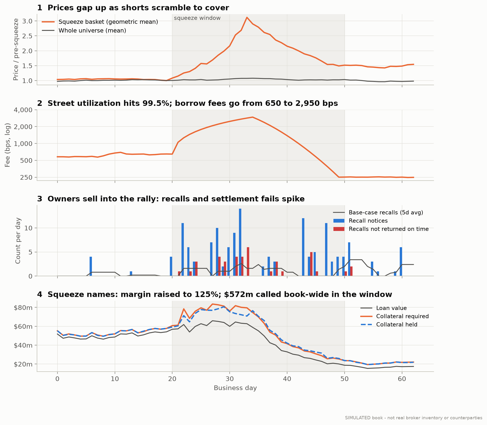

*The simulated short squeeze. Eight crowded shorts rally about 3x, street utilization hits 99.5%,
borrow fees go from about 650 to 2,950 bps, owners sell into the rally (forcing recalls), and the
margin requirement on squeeze names rises to 125%.*

### Results at a glance

Every number below is produced by `seclend run` (see [Reproduce](#reproduce)) and written to
[`results/`](results/). The method comparison uses 20 independent market paths. The single-path
figures use path seed 7.

| | Base quarter | Short-squeeze quarter |
|---|---|---|
| Average lendable / on loan | $36.8bn / $6.19bn | $36.8bn / $6.36bn |
| Utilization (value-weighted) | 16.8% | 17.3% |
| Average fee on loans | 34.5 bps | 39.9 bps |
| Gross lending revenue (optimizer) | $6.44m | $7.62m |
| Locate fill rate (by value) | 87.2% | 84.6% |
| Recalls / not returned on time / buy-ins | 63 / 11 / 0 | 147 / 40 / 6 |
| Fail, recall and buy-in costs (incl. lender's late deliveries) | $23k | $236k |
| **Optimizer vs first come, first served** (20 paths) | **+0.82%** net, 95% CI [+0.65, +0.99], wins 20/20 | **+2.45%**, CI [+1.62, +3.28], wins 20/20 |
| **Optimizer vs pro-rata** (20 paths) | **+0.51%**, CI [+0.38, +0.64], wins 18/20 | **+1.60%**, CI [+0.99, +2.21], wins 19/20 |
| Optimizer vs greedy, highest bid first (20 paths) | −0.06%, CI [−0.12, −0.00] | −0.11%, CI [−0.49, +0.27] |
| Expected recall cost of each day's new loans, vs greedy | about the same | **−27%**, for −0.67% gross revenue |

**The honest headline.** The optimizer reliably beats the two allocation rules desks actually
default to. It wins every path against first-come-first-served and 18–19 of 20 against pro-rata,
and the edge grows in a squeeze and when limits are tight (up to +9%). It does **not** beat a
well-built greedy rule that fills the highest bid first. In the base case it lands 0.06% below that
rule, a small but statistically real shortfall. The reason is structural, and §8 explains it: when
every binding constraint is a share count or a dollar limit, "highest fee first" is already close
to revenue-optimal. The optimizer's extra terms (recall risk, locate usage, relationship) cut the
**expected** recall cost of the shares it lends by 27% in the squeeze. Only a few percent of that
shows up in realised quarterly costs. About half of those costs are the lender's own late
deliveries, which allocation cannot change, and the rest is driven by a handful of lumpy buy-ins. The reasoning behind every number is in
**[ANALYSIS.md](ANALYSIS.md)**.

---

## Contents

1. [Securities lending, from zero](#1-securities-lending-from-zero)
2. [The lifecycle of a loan](#2-the-lifecycle-of-a-loan)
3. [Book architecture](#3-book-architecture)
4. [The economics](#4-the-economics)
5. [The allocation problem](#5-the-allocation-problem)
6. [Base-case results](#6-base-case-results)
7. [Short-squeeze stress](#7-short-squeeze-stress)
8. [When does optimization pay?](#8-when-does-optimization-pay)
9. [Risk controls](#9-risk-controls)
10. [Limitations](#10-limitations)
11. [Reproduce](#reproduce)

---

## 1. Securities lending, from zero

If you already know the business, skip to [Book architecture](#3-book-architecture).

### Why anyone borrows a share

To **sell a stock short**, betting that its price will fall, you have to deliver shares you don't
own. So you borrow them: you sell the borrowed shares today, buy them back later (hopefully
cheaper), and give them back to the lender. Market makers also borrow, to hedge options and ETF
positions and to settle trades on time.

On the other side are big long-term holders such as pension funds, insurers and index funds. They
own enormous amounts of stock that just sits there. Lending it out earns extra return at low risk,
because the borrower posts **collateral** worth more than the shares. The lending is usually run
for them by a custodian bank's lending desk, the **agent lender**. That desk is what this project
simulates.

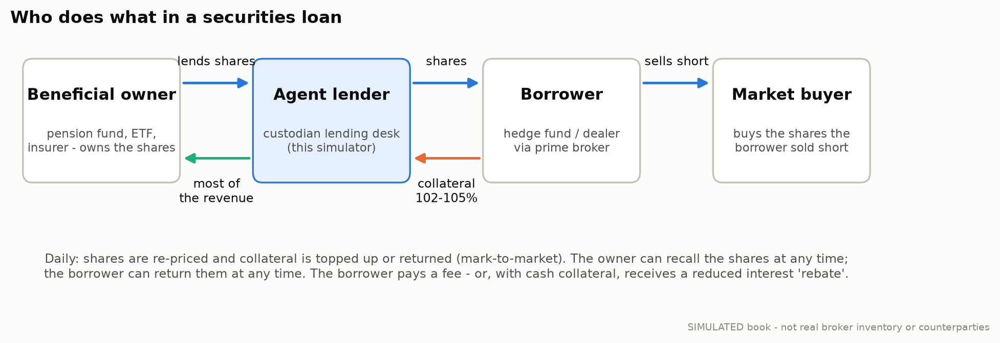

### A worked example

A hedge fund wants to short 100,000 shares of a $50 stock, which means a **$5.0m loan**.

1. **Locate.** Before shorting, the fund's broker must have reasonable grounds to believe the shares
   can be borrowed (US Reg SHO). It asks the lender for a *locate*. The lender answers yes, no, or
   "you can have 60,000".
2. **Borrow.** The shares move to the fund. The fund posts collateral of **102%** of the loan value,
   or $5.1m. If the collateral is cash, the lender invests it.
3. **Every day** the loan is re-priced. If the stock rises to $60, the loan is worth $6.0m and the
   lender now needs $6.12m, so it **calls** the fund for another $1.02m. If the stock falls, the
   fund asks for cash back.
4. **The fee.** An easy-to-borrow stock might cost 0.25% a year. A stock everyone wants to short can
   cost 10%, 50% or more.
5. **The end.** The fund *returns* the shares when it closes its short. Alternatively, the owner
   sells its shares and the lender **recalls** them, and the fund must hand them back within the
   settlement cycle (T+1 in the US). If it can't, the return **fails**. If the fail drags on, the
   lender **buys in**: it buys the shares in the market and charges the fund.

### General collateral vs hard to borrow

Most stocks are **general collateral (GC)**. Supply is plentiful, the fee is a flat ~25 bps, and
nobody fights over them. A minority are **specials** or **hard-to-borrow (HTB)**. These are crowded
shorts where borrow demand approaches the supply that exists. Their fee is set by scarcity, and it
behaves like a price that rises gently and then explodes as the last shares are taken:

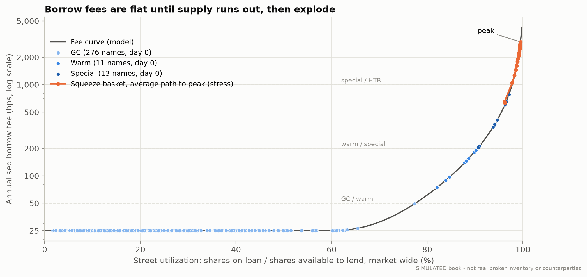

*Fee against **street utilization**, the share of the market's lendable supply already on loan.
Dots are SIMULATED securities on day 0 of the reporting window (276 GC, 11 warm, 13 special). The
orange path is the squeeze basket climbing to its peak. The curve's shape is a modelling assumption
(see [`config.py`](src/seclend/config.py)), because real fee data is proprietary.*

This is why a lending desk's revenue is so lopsided. In the simulated base quarter, warm and
special names are **2.3% of the value on loan but 26% of fee income**, and the top 10% of names
earn 66% of it. Those are exactly the names where supply runs out and allocation decisions matter.

---

## 2. The lifecycle of a loan

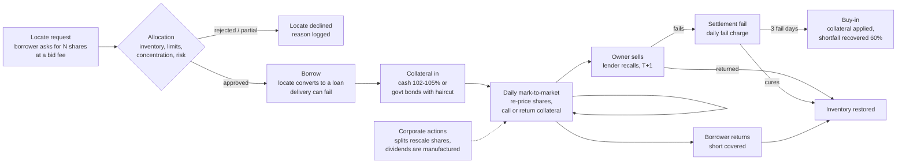

Each step is implemented in [`simulation.py`](src/seclend/simulation.py). They run once per
business day, in this order: corporate actions → owner trading → failing returns → recalls due
today → voluntary returns → new recalls → mark-to-market → fee accrual → new locates and borrows.

---

## 3. Book architecture

```
src/seclend/
  config.py       every modelling assumption, in one reviewable place
  economics.py    pure arithmetic: fee curve, rebate, ACT/360 accrual, collateral, MTM, buy-ins
  universe.py     SIMULATED securities (300) and counterparties (36), seeded
  market.py       exogenous paths: prices, utilization, fees, owner sales, corporate actions, demand
  allocation.py   AllocationProblem + FCFS, greedy, pro-rata and the LP optimizer
  simulation.py   the daily book: loan ledger, recalls, fails, buy-ins, collateral, accrual
  experiments.py  scenario runs, decision study, 20-path robustness, sweeps
  plots.py        every figure in this README
```

**Inventory.** Each security has a lendable quantity (our beneficial owners' holding, 0.2–1.5% of
float), a market price, a sector, a **concentration** (its share of total lendable value) and a
daily **utilization**. Owners sell part of a holding on a random 0.5–2.5% of days, and any sale can
force recalls. Large caps are always GC. Specials are drawn only from small and mid caps.

**Borrowers.** There are six SIMULATED types: multi-strategy, fundamental long/short, quant,
activist short, market maker and event-driven. Each counterparty has:
- an **exposure limit**
- a **relationship score**
- a **recall sensitivity** (how likely it is to fail a recall)
- a bid premium and dispersion (its **fee willingness**)
- a locate-to-borrow conversion rate
- a return hazard
- a collateral type and a credit rating

About 210 locate requests arrive per day. Each one names the shares/notional requested and a bid fee.

**Common random numbers.** Prices, demand and owner sales are generated once per scenario, and so
is every behavioural coin-flip (does this borrower return today, fail its recall, use its locate?).
Every allocation method runs against those same draws. Differences between methods are therefore
differences in decisions, not in luck.

A real slice of the locate log (base, optimizer, last day; [`results/locate_log_sample.csv`](results/locate_log_sample.csv)):

| security | counterparty | requested | bid (bps) | reserve (bps) | recall penalty (bps) | approved | reason |
|---|---|---:|---:|---:|---:|---:|---|
| SIM200 | SIM-CPTY-22 | 100 | 1,637 | 679 | 11.5 | 100 | filled |
| SIM266 | SIM-CPTY-23 | 45,900 | 1,515 | 467 | 118.2 | 0 | no inventory |
| SIM213 | SIM-CPTY-02 | 2,100 | 684 | 352 | 0.8 | 200 | no inventory |
| SIM200 | SIM-CPTY-11 | 700 | 676 | 679 | 4.0 | 0 | bid below reserve |
| SIM051 | SIM-CPTY-33 | 37,100 | 570 | 533 | 2.1 | 9,288 | no inventory |

Across the base quarter, 87.5% of requests are filled in full. The rest are cut by exhausted
inventory (5.1%), counterparty limits (4.7%), bids below the lender's reserve (2.2%), the optimizer
preferring other borrowers (0.4%), or the single-name cap (0.1%).

---

## 4. The economics

### Where the money comes from

US equity loans are usually collateralised with **cash**, and with cash collateral nobody writes a
cheque for "the fee". The lender invests the borrower's cash and pays the borrower interest on it
at a reduced rate, called the **rebate**:

> **rebate = cash benchmark − borrow fee**
>
> lender earns = reinvestment yield − rebate = **fee + reinvestment spread** (on the collateral balance)

For a GC stock the rebate is positive and the lender keeps a thin slice. For an HTB stock the fee is
bigger than the benchmark, so the **rebate goes negative**: the borrower pays interest *on its own
cash* for the privilege of borrowing.

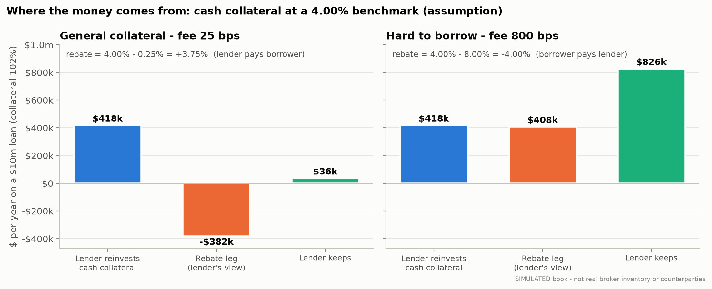

*Assumptions: a $10m loan for one year, 102% cash collateral, a 4.00% benchmark (not a market
quote) and a 10 bps reinvestment spread. On GC the lender keeps $36k. On HTB at 8% it keeps $826k,
23x more on the same loan. Unit-tested in [`tests/test_economics.py`](tests/test_economics.py).*

With **non-cash collateral** there is no rebate. Here that means government bonds at a 2% haircut,
and the borrower pays the fee directly on the loan value. In the simulation, market makers post
bonds and everyone else posts cash. The two revenue legs are reported separately: in the base
quarter, $5.12m of the $6.44m comes from fees and $1.32m from the reinvestment spread.

| Term | In this model |
|---|---|
| **Borrow fee** | Negotiated per loan. GC loans price near ~25 bps. Specials price at the borrower's bid, which is dispersed around the market fee |
| **Rebate** | Benchmark − fee, paid on cash collateral, ACT/360 |
| **Collateral rate** | The 4.00% benchmark, plus a 10 bps reinvestment spread |
| **Lender spread / revenue** | (fee + spread) × collateral for cash; fee × loan value for non-cash. Accrued daily, with weekend days accrued on Fridays |
| **Utilization** | On-loan value ÷ lendable value for the book; loaned ÷ lendable shares for the street |
| **Inventory opportunity cost** | Modelled as a **reserve fee**: the lender won't lend a name below 80% of its market fee, because those shares could go out at market tomorrow. 2.2% of requests are declined this way |
| **Agent split** | 20% to the agent and 80% to beneficial owners (illustrative). In the base quarter that is about $1.3m to the desk and $5.2m to owners |

### Collateral and mark-to-market

Collateral must cover **margin × loan value** after the haircut:
`required = margin × shares × price / (1 − haircut)`. Margin is 102% for GC and 105% for specials,
plus a rating add-on (+1% for BBB, +3% for BB). Every loan is marked daily, but collateral moves at
counterparty level. Each borrower's deficits and excesses are netted, and nothing moves below a
$250k minimum transfer amount or 0.5% of value. A borrower can also miss a call: the base rate is
1% a day, scaled by rating and tripled during a squeeze. Until the borrower pays, the lender carries
**uncovered exposure**.

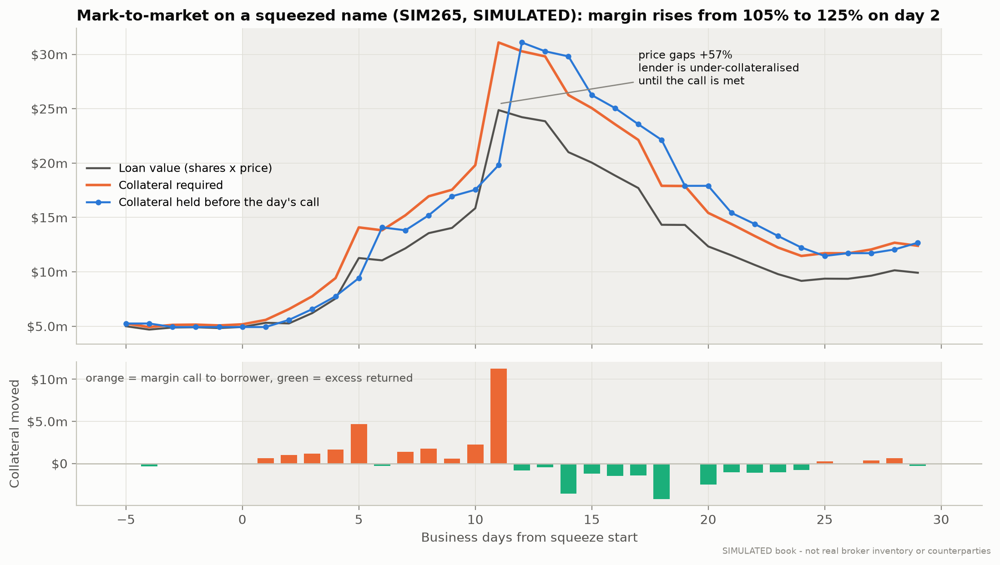

*One squeeze name from the stress run. The lender re-prices daily and calls collateral up to the
requirement. When the price gaps up 57% in a day, the lender is short of collateral until the call
is met. When the price falls back, the borrower takes cash back.*

### Corporate actions

- **Splits.** On the ex-date, loan shares and lendable quantity scale by the ratio and the price
  divides by it, so loan value is unchanged. The run includes four 2-for-1 splits and two
  1-for-10 reverse splits.
- **Cash dividends** (87 in the quarter). A borrower who sold the shares short doesn't receive the
  dividend, so it pays the lender a **manufactured dividend**. These total $6.0m in the base
  quarter. They are passed through to owners and not counted as revenue.

---

## 5. The allocation problem

Most days, demand for GC names is met in full. For specials it isn't. In the base quarter the
lender approves 89% of requested value in GC names, but only **30% in special names** and **16% on
days a name trades as HTB**. Someone has to decide **who gets the scarce shares**.

### The optimizer

Each request *i* asks for `qᵢ` shares of security `s(i)` at bid `fᵢ`, from borrower `b(i)`. The
optimizer chooses `xᵢ`, the number of shares to approve:

```
maximise   Σᵢ xᵢ · pᵢ · [ convᵢ · ( fᵢ − λ · recall_costᵢ ) + τ · relationshipᵢ ] / 10⁴ / 360

subject to Σ_{i∈s} xᵢ          ≤ available_s                          inventory
           Σ_{i∈b} pᵢ xᵢ       ≤ limit_b − exposure_b                 counterparty limit
           Σ_{i∈b} pᵢ xᵢ       ≤ 15% · book − exposure_b              counterparty concentration
           xᵢ                  ≤ 35% · lendable_s − held_{s,b}        single-name concentration
           xᵢ                  ≤ qᵢ ,   xᵢ ≥ minᵢ (optional)          request size, relationship minimums
           fᵢ                  ≥ 80% · market_fee_s                   reserve (applied to every method)
```

This is a linear programme with about 210 variables per day. HiGHS (`scipy.optimize.linprog`)
solves it in milliseconds, and the result is floored to whole shares. The terms:

- **`recall_costᵢ`** is the *ex-ante expected* cost of lending to this borrower in this name, in
  annualised bps. It equals P(owner sells today) × P(this borrower fails the recall) × (fail charges
  + expected buy-in shortfall). It uses only what the desk knows that day: the long-run owner sale
  rate, sales seen over the last 10 days, yesterday's utilization and trailing volatility.
- **`convᵢ`** is the borrower's locate-to-borrow conversion rate. An approved locate that is never
  used earns nothing and leaves the shares idle for the day.
- **`τ = 5 bps`** is a small tilt toward relationship borrowers.

### The methods compared

| Method | Rule |
|---|---|
| **First come, first served (FCFS)** | Fill locates in arrival order, the natural default of a locate queue |
| **Pro-rata** | Split each name's shares in proportion to request size |
| **Greedy (highest bid)** | Fill the highest bids first, one request at a time |
| **LP, gross revenue** | The optimizer with no risk, conversion or relationship terms |
| **LP, risk-adjusted** | The full objective above (the "optimizer" in this README) |
| **LP + minimums** | Adds a policy: borrowers with relationship ≥ 0.85 get at least 25% of their request where feasible |

Every method obeys the same hard constraints. This is checked on every simulated day and in the
tests, so differences come only from the decision rule.

### Why greedy can lose: a two-borrower example

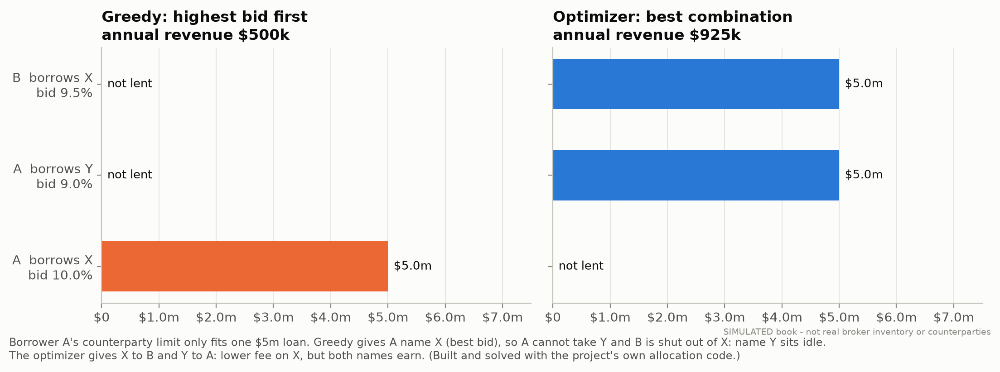

Greedy is myopic. Borrower A's counterparty limit fits only one $5m loan. Greedy gives A its best
bid (name X at 10%), which uses up A's limit and shuts B out of X, so name Y sits idle. The
optimizer looks at both names at once: it gives X to B and Y to A, and annual revenue goes from
**$500k to $925k**. This example is solved by the project's own code and asserted in
`test_toy_example_optimizer_beats_greedy_because_of_a_counterparty_limit`.

---

## 6. Base-case results

### Revenue by allocation method

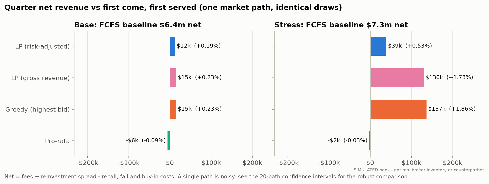

On the single path behind the tables, the methods are within 0.3% of each other in the base case.
In the squeeze, FCFS and pro-rata fall about 1.8% behind greedy and the gross-revenue LP. The
risk-adjusted LP lands in between on this path. One buy-in on a squeeze name cost it $66k, more than
the entire gap between methods: buy-ins are rare and lumpy. Because a single path is this noisy,
the comparison that counts is the one repeated across 20 independent market paths:

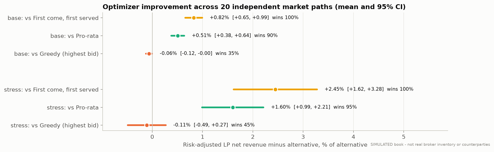

| Net revenue, optimizer minus … | Base | Stress |
|---|---|---|
| First come, first served | **+0.82%** [+0.65, +0.99], wins 20/20 | **+2.45%** [+1.62, +3.28], wins 20/20 |
| Pro-rata | **+0.51%** [+0.38, +0.64], wins 18/20 | **+1.60%** [+0.99, +2.21], wins 19/20 |
| Greedy (highest bid) | −0.06% [−0.12, −0.00], wins 7/20 | −0.11% [−0.49, +0.27], wins 9/20 |

*Mean paired difference with a 95% t-interval over 20 paths ([`results/robustness_paired.csv`](results/robustness_paired.csv)).
In dollars, the edge over FCFS is about $61k per quarter in the base case and $230k in the squeeze.*

### The decision itself, from the same state

A full quarter mixes the quality of each decision with everything that follows from it. Unmet
demand comes back the next day, recalled shares get re-lent, and so on. To isolate the decision,
every daily problem the desk faced was re-solved by every method **starting from the identical
state**:

| Daily allocation, summed over the quarter | FCFS | Pro-rata | Greedy | LP |
|---|---:|---:|---:|---:|
| Base: objective vs FCFS | — | +0.62% | +1.03% | **+1.08%** |
| Stress: objective vs FCFS | — | +0.94% | +2.71% | **+3.46%** |
| Stress: expected recall cost of the day's loans ($/day) | 7,141 | 6,745 | 7,125 | **5,176** |
| LP ≥ method on every day (within one share per request) | 63/63 | 63/63 | 63/63 | — |

On each individual day, the LP is never beaten on its objective. In the squeeze it allocates the
same inventory as greedy at **27% lower expected recall cost**, giving up 0.67% of that day's gross
revenue.

### Scarcity and concentration

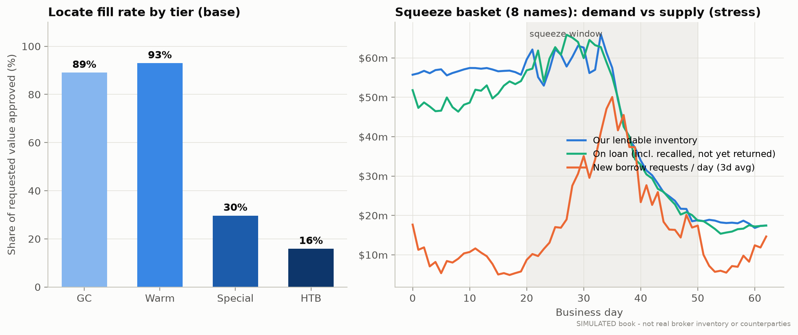

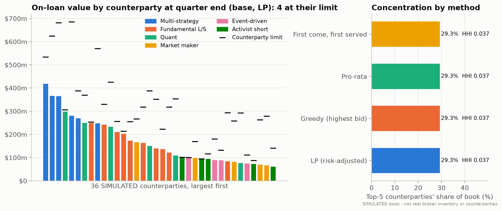

The book is diversified, but the limits are real. Across 36 counterparties the average HHI is
0.037, the top five hold 29% of the book, and four counterparties end the quarter at their exposure
limit. Concentration barely moves between methods, because the 15% book-share cap and the
counterparty limits bind no matter which rule allocates.

---

## 7. Short-squeeze stress

The stress scenario reuses the base market and squeezes eight crowded small and mid caps from
day 20:

| Stress lever | Implementation | Simulated outcome |
|---|---|---|
| Utilization → 100% | Street utilization ramps to 99.5% by day 34, then unwinds | Basket average 99.5% at peak |
| Fees jump | The fee curve, evaluated at that utilization | Basket fee goes from 650 to **2,950 bps** |
| Prices gap | Jumpy run-up to 2–4x, then a partial collapse | Basket **2.97x** at peak; single-day gaps up to +57% |
| Inventory scarce, recalls rise | Owners sell on 10% of days in squeeze names (2x the normal rate in other specials) | Recalls rise from 63 to **147**, peaking at 14 in one day; squeeze-name lendable falls from about $56m to $18m |
| Borrowers can't return | Fail probability scales up to 9x as utilization nears 100% | Late returns rise from 11 to 40; **6 buy-ins** |
| Collateral requirements change | Squeeze-name margin goes from 105% to **125%**; missed calls triple | Peak uncovered exposure rises from $5.6m to $11.7m; $146m called on the worst day |
| Shorts cover | Return hazard up to 10% a day | Borrowers hand back shares into the rally |

**For the lender, a squeeze is a windfall that comes with costs.** Gross revenue rises 18% over the
base quarter ($7.62m vs $6.44m), driven by fees of up to 30% a year on the squeeze names. Recall,
fail and buy-in costs rise **10x**, from $23k to $236k, about 3% of revenue. On this path, $118k of
that is the lender's *own* late deliveries (3% of new loans settle late in the squeeze), $79k is six
buy-ins, and the rest is recall notices and borrower fail charges.

### The price of safety

The optimizer's risk term is `λ × expected recall cost`. Raising λ above 1 trades revenue for
safety:

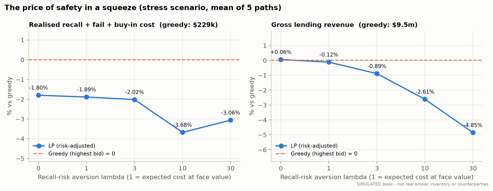

At λ = 1 the optimizer's realised recall costs are 1.9% below greedy's, for 0.12% less revenue.
Pushing λ to 10 cuts recall costs by 3.7% and gives up 2.6% of revenue. In dollars, every step
beyond λ = 1 costs more revenue than it saves. The large *ex-ante* saving (27% of the expected cost
of new loans) shrinks to a few percent *realised*, for three reasons:

1. **Much of the cost isn't allocatable.** About half of stress-quarter fail costs are the lender's
   own late deliveries, and these happen whoever gets the shares.
2. **Buy-ins are rare and lumpy.** There are six a quarter on this path. A single $66k buy-in
   outweighs the whole expected-cost saving, so 20 paths can't separate the methods on realised
   recall cost (optimizer vs greedy: −0.1%, 95% CI −3.3% to +3.0%).
3. **Near 100% utilization, everyone struggles to return.** The scarcity multiplier (up to 9x)
   applies to every borrower. Borrower-specific recall sensitivity (0.4–2.5x), the part allocation
   can influence, is smaller.

The useful lever in a squeeze is therefore collateral and limits (125% margin, call discipline),
not a heavier risk penalty in the allocator.

---

## 8. When does optimization pay?

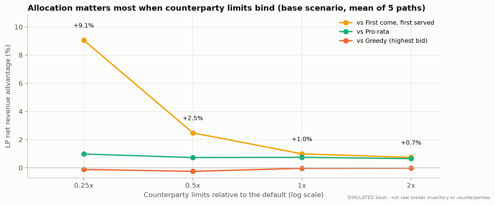

Scaling every counterparty limit shows where allocation quality matters. When limits are tight
(0.25x), FCFS spends scarce limit room on whichever low-fee request happens to arrive first, and the
optimizer earns **+9.1%** more. At 0.5x the edge is +2.5%, at the default limits +1.0%, and at 2x
+0.7%. Against greedy the gap stays between −0.25% and −0.03% at every setting.

**Why highest-bid greedy is almost optimal here.** Within one name, every request has the same
price. So revenue per share and revenue per dollar of counterparty limit rank requests by the same
number: the bid. When the objective and every binding constraint agree on that ranking, filling in
bid order lands within a hair of the LP optimum. Greedy goes wrong only when that ranking breaks:

- risk that differs by borrower and name (§7)
- borrowers who use their locates at different rates
- limits that bind across several names at once (the two-borrower example above)
- policy constraints. Here, guaranteeing relationship minimums costs 0.07% of revenue.

In this calibration those cases are real but small. A desk with more heterogeneous borrower risk,
or tighter limits, would see more value from the optimizer. Where greedy is already good, the case
for the LP is control rather than revenue: one auditable objective that carries risk, policy and
concentration terms explicitly.

---

## 9. Risk controls

| Control | Where | Behaviour |
|---|---|---|
| Inventory | Allocation | Never approve more than lendable − on loan (including recalled shares still in transit) |
| Counterparty limit | Allocation | Gross loan value ≤ limit. Breaches happen only passively, through price moves (peak 1.03x of limit), and they block new lending to that borrower |
| Book-share cap | Allocation | One borrower ≤ 15% of the start-of-day book |
| Single-name cap | Allocation | One borrower ≤ 35% of a name's lendable, so no single borrower corners our supply |
| Reserve fee | Allocation | No special lent below 80% of its market fee |
| Recall-risk pricing | Optimizer | Expected recall cost is charged against the fee |
| Margin and haircut | Daily | 102% GC, 105% special, 125% in a squeeze, plus rating add-ons. Bonds at a 2% haircut |
| Daily MTM | Daily | Netted per counterparty, with a $250k minimum transfer. Missed calls are tracked as uncovered exposure |
| Recall policy | Daily | Recall the cheapest, weakest-relationship loans first. T+1 return |
| Fails and buy-ins | Daily | Daily fail charge of 5 bps of notional. Buy-in after 3 fail days. Any shortfall over collateral is recovered at 60% |
| Invariant checks | Every day, every run | `al.violations()` raises if any allocation breaches a hard constraint. `CheckedBook` in the tests asserts inventory invariants daily |

---

## 10. Limitations

- **Synthetic data.** The universe, borrower behaviour, the fee curve and every parameter in
  [`config.py`](src/seclend/config.py) are assumptions, chosen to be plausible and internally
  consistent. None is calibrated to proprietary lending data, which isn't public. Prices are
  simulated as geometric Brownian motion with market and sector factors. No public price data is
  used, so the project runs fully offline.
- **Dollar figures are illustrative.** The ~35 bps average fee and the revenue concentration in
  specials are broadly in the shape usually described for agency programs. They are still outputs
  of assumed parameters, not estimates of any real book.
- **Lendable inventory drifts down** from $49.6bn at generation to an average of about $36.8bn over
  the reporting window, because owner sales outpace additions in the inventory process.
- **The optimizer knows the fail model's structure.** Its recall-cost estimate uses the simulator's
  functional form with observable inputs. That is optimistic; a real desk would estimate the model
  with error.
- **One-day horizon.** Each allocation is myopic. It does not hold back limit room or inventory for
  better bids expected tomorrow. A rolling-horizon version is the natural next step, and it is the
  most likely way to beat greedy on revenue.
- **Simplifications.** The model has no term or open-vs-term structure and no borrower default
  (only missed calls and buy-in shortfalls). It also leaves out tri-party and cross-currency
  collateral, the tax treatment of manufactured dividends, intraday timing beyond FCFS arrival
  order, and regulatory capital or balance-sheet costs.
- **Fail charges, buy-in slippage and recovery** are stylised parameters, not market conventions.

---

## Reproduce

```bash
git clone https://github.com/crollila/securities-lending-equity-finance.git
```

```bash
cd securities-lending-equity-finance && pip install -e ".[dev]"
```

```bash
seclend run
```

That single command regenerates every CSV in `results/`, every figure in `figures/`, and
`results/headline.json`. It takes about 6 minutes (20 robustness paths plus two sweeps).
`seclend run --quick` uses 3 paths and finishes in about a minute. Run the tests with:

```bash
pytest -q
```

CI runs lint and all 126 tests on Ubuntu and Windows, under Python 3.11 and 3.12. It then re-runs
the scenario experiments and fails if the committed tables quoted here drift from what the code
produces (`scripts/check_results.py`).

| Output | What it holds |
|---|---|
| `summary_by_method.csv` | Every metric, for every method, in both scenarios |
| `decision_study_summary.csv`, `decision_study_daily.csv` | The same-state comparison of allocation decisions |
| `robustness_by_seed.csv`, `robustness_paired.csv` | The 20-path comparison with confidence intervals |
| `sweep_counterparty_limits.csv`, `sweep_recall_risk_aversion.csv` | The two sweeps |
| `daily_<scenario>_<method>.csv` | The daily book: revenue, utilization, recalls, fails, calls, concentration |
| `events_stress_optimized.csv` | Every recall, fail, cure, buy-in and split in the stress run |
| `universe_simulated.csv`, `borrowers_simulated.csv` | The SIMULATED inventory and counterparties |
| `locate_log_sample.csv`, `corporate_actions.csv`, `counterparty_concentration.csv`, `fee_curve.csv` | Supporting detail |

The charts share one light background, a recessive grid and a fixed categorical palette. Adjacent
colours have been checked for colour-vision deficiency, and every chart is labelled SIMULATED.

## License

MIT, see [LICENSE](LICENSE).
